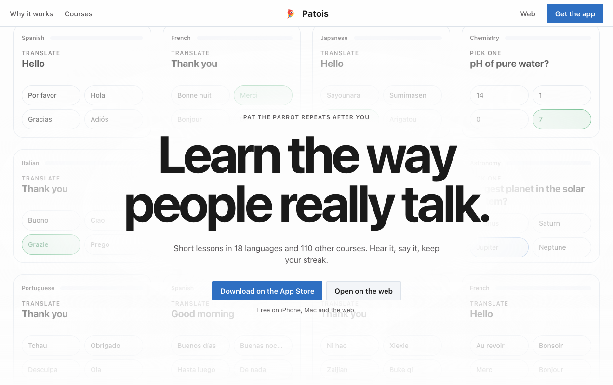
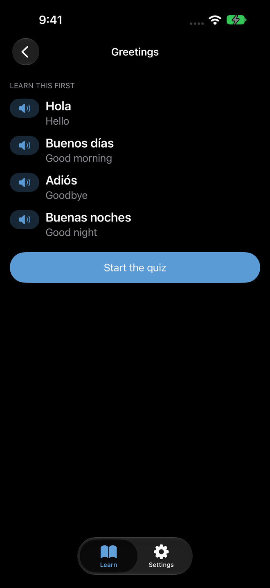

[](LICENSE) [](https://apps.apple.com/app/id6783501611)

Learn a language, or anything else, five minutes at a time. Web, iPhone, Mac and Watch.

[patois.jaybulb.com](https://patois.jaybulb.com) · [App Store](https://apps.apple.com/app/id6783501611)

<p>
  
  
</p>

## Features

- 128 courses: languages, code, math, science, chess and more
- Short lessons with a tip first and an explanation on every answer
- Streaks, XP and spaced review, synced across devices

## Run

```bash
npx serve .                      # local
node tools/validate-catalog.js   # check content
./scripts/deploy.sh              # deploy (a push does not)
```

Sentences from [Tatoeba](https://tatoeba.org) (CC-BY 2.0 FR), chess puzzles from [Lichess](https://database.lichess.org/#puzzles) (CC0). More in [Architecture](docs/ARCHITECTURE.md) and [Attribution](ATTRIBUTION.md).
